# OOP2026
### Homework1
```java
package homework;
public class Homework {
    public static void main(String[] args) {
        int i, j;

        for (i = 0; i < 10; i++) {
            for (j = 0; j <= i; j++) {
                System.out.print("#");
            }
            System.out.println();
        }

        System.out.println();

        for (i = 0; i < 10; i++) {
            for (j = 0; j < 10 - i; j++) {
                System.out.print("#");
            }
            System.out.println();
        }

        System.out.println();

        for (i = 0; i < 10; i++) {
            for (j = 0; j < 9 - i; j++) {
                System.out.print(" ");
            }
            for (j = 0; j <= i; j++) {
                System.out.print("#");
            }
            System.out.println();
        }

        System.out.println();

        for (i = 0; i < 10; i++) {
            for (j = 0; j < i; j++) {
                System.out.print(" ");
            }
            for (j = 0; j < 10 - i; j++) {
                System.out.print("#");
            }
            System.out.println();
        }
    }
}

```
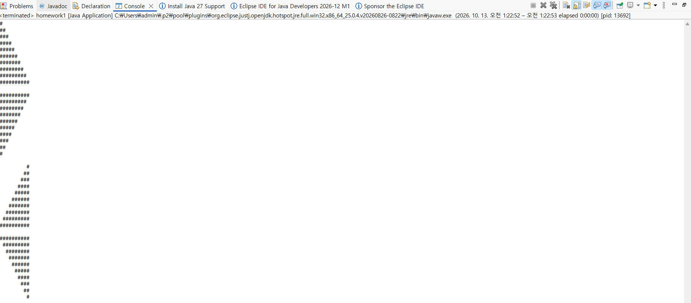

### Homework2
```java
package homework;
public class Homework {
    public static void main(String[] args) {
        int a = 0, b = 1, c;

        for (int i = 0; i < 20; i++) {
            System.out.print(a + " ");

            c = a + b;
            a = b;
            b = c;
        }
    }
}
```
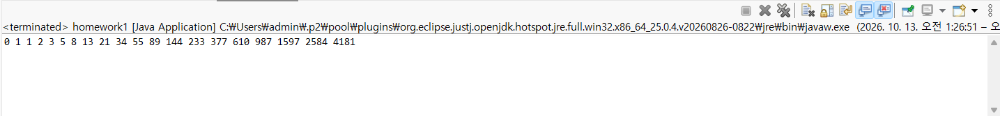

### Homework3
```java
package homework;

public class Homework {
    public static void main(String[] args) {
        int a = 0, b = 1, c;
        double ratio;

        for (int i = 1; i <= 20; i++) {
            c = a + b;
            a = b;
            b = c;

            ratio = (double) b / a;

            System.out.println(i + "번째 황금비율: " + ratio);
        }
    }
}
```
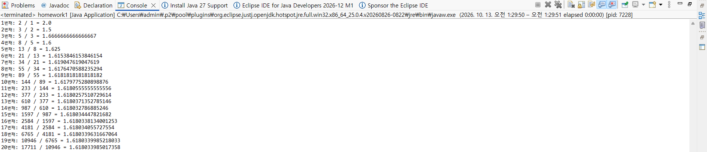

### Homework4
```java
package homework;

public class Homework {
    public static void main(String[] args) {
        int i, j;

        for (i = 1; i <= 9; i++) {
            for (j = 1; j <= 9; j++) {
                System.out.print(i + " * " + j + " = " + (i * j) + "\t");
            }
            System.out.println();
        }
    }
}
```
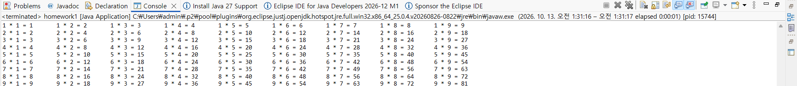

### Homework5
```java
package homework;

public class Homework {
    public static void main(String[] args) {
        double pi = 0.0;
        int sign = 1;

        for (int i = 0; i < 100000; i++) {
            pi += (double) sign / (2 * i + 1);
            sign = -sign;
        }

        pi = pi * 4;

        System.out.println("계산한 원주율: " + pi);
        System.out.println("실제 원주율: " + Math.PI);
    }
}
```
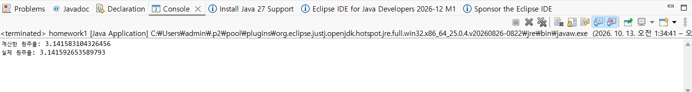

### Homework6
```java
package homework;

public class Homework {
    public static void main(String[] args) {
        int binomial[][] = new int[6][6];

        for (int i = 0; i < 6; i++) {
            for (int j = 0; j <= i; j++) {
                if (j == 0 || j == i) {
                    binomial[i][j] = 1;
                } else {
                    binomial[i][j] = binomial[i - 1][j - 1]
                                   + binomial[i - 1][j];
                }
            }
        }

        for (int i = 0; i < 6; i++) {
            for (int j = 0; j <= i; j++) {
                System.out.print(binomial[i][j] + " ");
            }
            System.out.println();
        }
    }
}
```
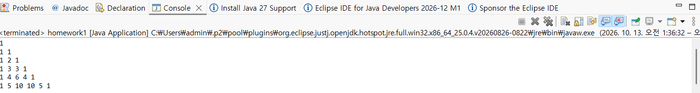

### Homework7
```java
package homework;

public class Homework {
    public static void main(String[] args) {
        int data[] = new int[20];

        for (int i = 0; i < 20; i++)
            data[i] = (int)(Math.random() * 100);

        for (int i = 0; i < 19; i++) {
            for (int j = 0; j < 19 - i; j++) {
                if (data[j] > data[j + 1]) {
                    int temp = data[j];
                    data[j] = data[j + 1];
                    data[j + 1] = temp;
                }
            }
        }

        for (int i = 0; i < 20; i++)
            System.out.print(data[i] + " ");
    }
}
```
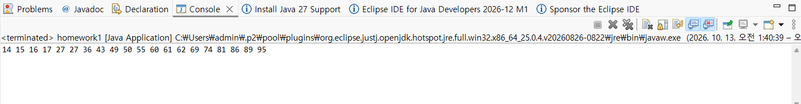

### Homework8
```java
package homework;

public class Homework {
    public static void main(String[] args) {
        int score[][] = new int[30][5];

        for (int i = 0; i < 30; i++) {
            int sum = 0;

            for (int j = 0; j < 4; j++) {
                score[i][j] = (int)(Math.random() * 101);
                sum += score[i][j];
            }

            score[i][4] = sum;
        }

        System.out.println("번호\t국어\t영어\t수학\t과학\t총점");

        for (int i = 0; i < 30; i++) {
            System.out.print((i + 1) + "\t");

            for (int j = 0; j < 5; j++) {
                System.out.print(score[i][j] + "\t");
            }

            System.out.println();
        }
    }
}
```
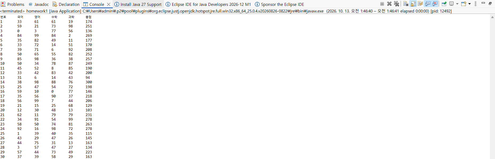

### Homework10
```java
package homework;

public class Homework {
    public static void main(String[] args) {
        int array_count, max_value, bin_size, display_scale, hist_size;

        if (args.length != 4)
            return;

        array_count = Integer.parseInt(args[0]);
        max_value = Integer.parseInt(args[1]);
        bin_size = Integer.parseInt(args[2]);
        display_scale = Integer.parseInt(args[3]);

        hist_size = max_value / bin_size;

        int[] arr = new int[array_count];
        int[] hist = new int[hist_size];

        for (int i = 0; i < array_count; i++) {
            arr[i] = (int)(Math.random() * max_value);
        }

        for (int i = 0; i < array_count; i++) {
            hist[arr[i] / bin_size]++;
        }

        for (int i = 0; i < hist_size; i++) {
            System.out.printf("%d~%d\t",
                    i * bin_size, (i + 1) * bin_size - 1);

            for (int j = 0; j < hist[i] / display_scale; j++) {
                System.out.print("#");
            }

            System.out.println();
        }
    }
}
```
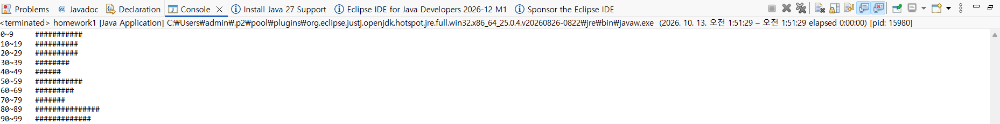

### Homework11
```java
package homework;

public class Homework {
    public static void main(String[] args) {
        int array_count;

        if (args.length != 1)
            return;

        array_count = Integer.parseInt(args[0]);

        int[] arr = new int[array_count];

        for (int i = 0; i < array_count; i++) {
            arr[i] = (int)(Math.random() * 100);
        }

        System.out.print("data: ");
        for (int i = 0; i < array_count; i++) {
            System.out.print(arr[i] + " ");
        }
        System.out.println();

        double sum = 0;
        double prod = 1;
        double reciprocalSum = 0;

        for (int i = 0; i < array_count; i++) {
            sum += arr[i];
            prod *= arr[i];
            reciprocalSum += 1.0 / arr[i];
        }

        System.out.printf("arithmetic mean = %f\n",
                sum / array_count);

        System.out.printf("geometric mean = %f\n",
                Math.pow(prod, 1.0 / array_count));

        System.out.printf("harmonic mean = %f\n",
                array_count / reciprocalSum);

        for (int i = 0; i < array_count - 1; i++) {
            for (int j = 0; j < array_count - 1 - i; j++) {
                if (arr[j] > arr[j + 1]) {
                    int temp = arr[j];
                    arr[j] = arr[j + 1];
                    arr[j + 1] = temp;
                }
            }
        }

        double median;

        if (array_count % 2 == 1) {
            median = arr[array_count / 2];
        } else {
            median = (arr[array_count / 2 - 1]
                    + arr[array_count / 2]) / 2.0;
        }

        System.out.printf("median = %f\n", median);
    }
}
```
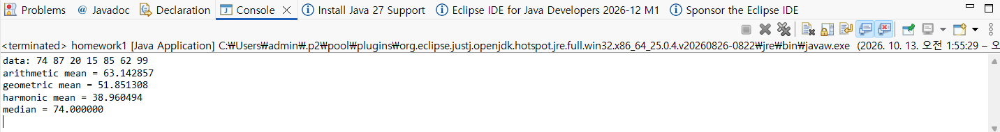


### Homework13
```java
package homework;

import java.util.Scanner;

public class Homework {
    public static void main(String[] args) {
        Scanner scanner = new Scanner(System.in);

        while (true) {
            String input = scanner.nextLine().trim();

            if (input.equals("exit")) {
                break;
            }

            String[] arr = input.split("\\s+");

            if (arr.length < 3 || arr.length > 7 || arr.length % 2 == 0) {
                continue;
            }

            double[] numbers = new double[4];
            String[] operators = new String[3];
            boolean valid = true;

            for (int i = 0; i < arr.length; i++) {
                if (i % 2 == 0) {
                    try {
                        numbers[i / 2] = Double.parseDouble(arr[i]);
                    } catch (NumberFormatException e) {
                        valid = false;
                        break;
                    }
                } else {
                    if (arr[i].equals("+") || arr[i].equals("-")
                            || arr[i].equals("/") || arr[i].equals("#")) {
                        operators[i / 2] = arr[i];
                    } else {
                        valid = false;
                        break;
                    }
                }
            }

            if (!valid) {
                continue;
            }

            int numberCount = arr.length / 2 + 1;
            int operatorCount = numberCount - 1;

            for (int i = 0; i < operatorCount; i++) {
                if (operators[i].equals("#") || operators[i].equals("/")) {
                    if (operators[i].equals("/") && numbers[i + 1] == 0) {
                        valid = false;
                        break;
                    }

                    if (operators[i].equals("#")) {
                        numbers[i] *= numbers[i + 1];
                    } else {
                        numbers[i] /= numbers[i + 1];
                    }

                    for (int j = i + 1; j < numberCount - 1; j++) {
                        numbers[j] = numbers[j + 1];
                    }

                    for (int j = i; j < operatorCount - 1; j++) {
                        operators[j] = operators[j + 1];
                    }

                    numberCount--;
                    operatorCount--;
                    i--;
                }
            }

            if (!valid) {
                continue;
            }

            double result = numbers[0];

            for (int i = 0; i < operatorCount; i++) {
                if (operators[i].equals("+")) {
                    result += numbers[i + 1];
                } else if (operators[i].equals("-")) {
                    result -= numbers[i + 1];
                }
            }

            System.out.println(result);
        }

        scanner.close();
    }
}
```
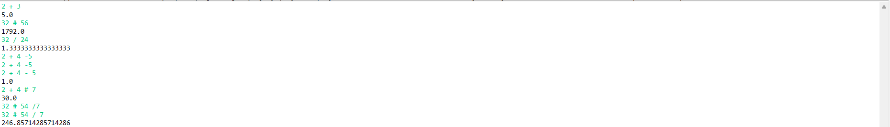

### Homework14
```java
package homework;

public class Numbers {
    int num[];

    Numbers(int num[]) {
        this.num = num;
    }

    double getTotal() {
        double sum = 0;

        for (int i = 0; i < num.length; i++) {
            sum += num[i];
        }

        return sum;
    }

    double getArithmaticMean() {
        if (num.length == 0) return 0;
        return getTotal() / num.length;
    }

    double getHarmonicMean() {
        if (num.length == 0) return 0;

        double sum = 0;

        for (int i = 0; i < num.length; i++) {
            if (num[i] == 0) return 0;
            sum += 1.0 / num[i];
        }

        return num.length / sum;
    }

    double getGeometricMean() {
        if (num.length == 0) return 0;

        double logSum = 0;

        for (int i = 0; i < num.length; i++) {
            if (num[i] == 0) return 0;
            logSum += Math.log(num[i]);
        }

        return Math.exp(logSum / num.length);
    }

    double getMedian() {
        if (num.length == 0) return 0;

        sorting();

        int middle = num.length / 2;

        if (num.length % 2 == 1) {
            return num[middle];
        } else {
            return (num[middle - 1] + num[middle]) / 2.0;
        }
    }

    void sorting() {
        for (int i = 0; i < num.length - 1; i++) {
            for (int j = 0; j < num.length - 1 - i; j++) {
                if (num[j] > num[j + 1]) {
                    int temp = num[j];
                    num[j] = num[j + 1];
                    num[j + 1] = temp;
                }
            }
        }
    }

    void drawHistogram(int start, int end, int binCount, int scale) {
        if (binCount <= 0 || end <= start || scale <= 0) return;

        int binWidth = (end - start) / binCount;

        if (binWidth <= 0 || (end - start) % binCount != 0) return;

        for (int i = 0; i < binCount; i++) {
            int lower = start + i * binWidth;
            int upper = lower + binWidth;
            int frequency = 0;

            for (int j = 0; j < num.length; j++) {
                if (num[j] >= lower && num[j] < upper) {
                    frequency++;
                }
            }

            System.out.printf("%3d~%3d : ", lower, upper - 1);

            for (int j = 0; j < frequency / scale; j++) {
                System.out.print("#");
            }

            System.out.println(" (" + frequency + ")");
        }
    }

    void display() {
        System.out.printf("%3d :", num.length);

        for (int i = 0; i < num.length; i++) {
            System.out.printf("%3d ", num[i]);
        }

        System.out.println();
    }
}
```
```java
package homework;

public class NumbersTest {
    public static void main(String[] args) {
        int size = 100;
        int data[] = new int[size];

        for (int i = 0; i < size; i++) {
            data[i] = (int)(Math.random() * 100);
        }

        Numbers obj = new Numbers(data);

        obj.display();

        System.out.printf("Arithmetic Mean : %5.2f\n",
                obj.getArithmaticMean());

        System.out.printf("Geometric Mean : %5.2f\n",
                obj.getGeometricMean());

        System.out.printf("Harmonic Mean : %5.2f\n",
                obj.getHarmonicMean());

        System.out.printf("Median : %5.2f\n",
                obj.getMedian());

        System.out.println("\nHistogram:");

        obj.drawHistogram(0, 100, 10, 1);
    }
}
```
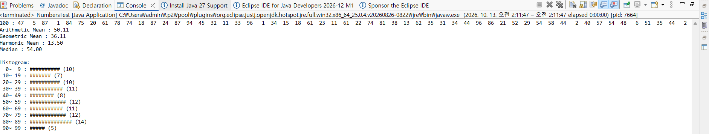
